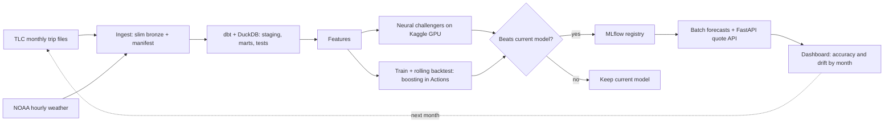

# NYC Ride Demand: forecasting through a policy shock

[](https://github.com/Andreas142/nyc-ride-demand/actions/workflows/ci.yml)

An end-to-end data science and ML engineering system built on hundreds of millions of real
NYC taxi and rideshare trips, retrained every month as the city publishes new data, and
tested against a real shock: congestion pricing in Manhattan from 5 January 2025.

> **Status:** Module 1 (data platform) in progress. Results, charts and live links are added
> here as each module ships.

## Questions this project answers

1. **Forecasting:** how many rides will each NYC zone need in the coming hours, with a range?
2. **Causal inference:** what did congestion pricing do to trips, fares and trip times inside
   the zone compared with outside it?
3. **Experimentation:** how would a ride-hailing marketplace test a pricing change, and how
   many zone-hours would it need to detect the effect?
4. **ML engineering:** does the production model stay accurate as the city changes, and does
   the system notice and recover when it does not?

## Architecture



## Roadmap

- [ ] **1. Data platform:** monthly ingestion, dbt models and data tests, zone-hour demand mart
- [ ] **2. Demand forecast:** LightGBM, XGBoost and CatBoost tuned with Optuna, with prediction ranges, beating seasonal baselines in rolling backtests
- [ ] **3. Causal study:** difference-in-differences, event study and synthetic control on congestion pricing
- [ ] **5. MLOps:** MLflow registry, monthly retraining with a champion-challenger gate, drift reports
- [ ] **2b. Deep learning challengers:** Chronos-2 zero-shot, N-HiTS and TFT, and an own spatio-temporal graph model in PyTorch, scored in the same backtest
- [ ] **4. Experiment design:** switchback test for a pricing change, power analysis, CUPED, A/A checks on real history
- [ ] **6. Serving:** batch forecasts and a FastAPI fare/ETA quote endpoint (ONNX Runtime) on Hugging Face Spaces, plus a Streamlit dashboard

Modules are numbered by topic and built in the order listed. Every model, boosted or neural,
is scored on the same folds, and the champion-challenger gate decides which one serves.

## Quickstart

In GitHub Codespaces (recommended; the dev container installs everything):

```bash
make sample   # zones, weather, and Dec 2024 - Feb 2025 for yellow taxis and Uber/Lyft, built and tested
make status   # months in bronze, in the marts, and pruned to a sample
```

Locally with Python 3.11+: `make setup` first. `make help` lists every target.

The sample is enough to develop against. `make backfill` processes every month in
`configs/project.yaml`, one at a time: ingest the month, build it into the marts with dbt,
then replace the trip-level files of older months with a 2% sample. It can be interrupted
and resumed with the same command, and `make dbt-build MONTH=2025-03` rebuilds one month.
The warehouse stays small enough for a free Codespace (see ADR-007 in the decision log).

Later modules add their own tools when they start: `make setup-ml` (module 2 onwards) and
`make setup-dl` (module 2b, CPU PyTorch). GPU training for the neural models runs on Kaggle;
[docs/compute.md](docs/compute.md) says where each step runs and what the free limits are.

## Repository layout

```
configs/project.yaml       months, services, paths, DuckDB limits
src/nycdemand/ingest/      TLC trip records, taxi zones, NOAA weather -> data/bronze
src/nycdemand/pipeline.py  month by month: ingest, build the marts, prune older trip files
dbt/models/intermediate/   every trip on one schema, with a flag per validity rule
dbt/models/staging/        valid trips, taxi zones, hourly weather
dbt/models/marts/          fct_zone_hour_demand, fct_od_day, dim_zones, mart_filter_audit
dbt/tests/                 data tests (grain, complete grid, audit adds up, volume warnings)
tests/                     unit tests and an end-to-end pipeline test
docs/                      data sources, decision log, compute plan
notebooks/                 exploration only
```

## Data and decisions

- [Data sources, freshness and caveats](docs/data_sources.md)
- [Decision log](docs/decisions.md)
- [Compute: where each step runs](docs/compute.md)

All results come from real public data. Tests use a few hand-written rows to exercise code.

## Author

Andreas Othonos · [GitHub](https://github.com/Andreas142)
